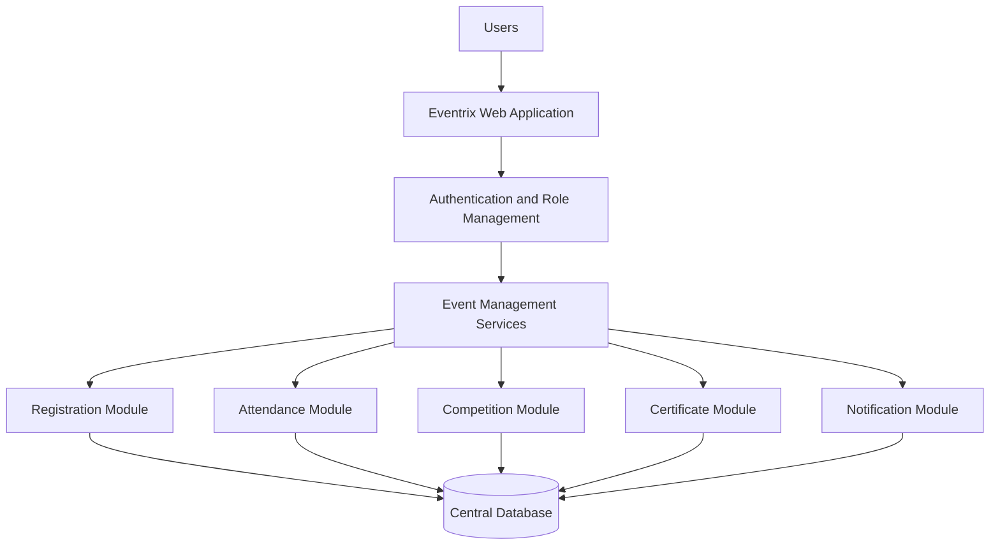
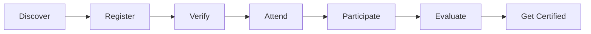

<div align="center">

# 🎯 Eventrix

### Smart Event Management & Automation Platform

**One Platform. Every Event. Seamless Experience.**


</div>

---

## 📌 Overview

**Eventrix** is a modern event management and automation platform designed to simplify the entire event lifecycle for educational institutions, communities, and organizations.

The platform brings event discovery, registrations, attendance tracking, competition management, participant communication, and certificate distribution into a unified digital ecosystem.

Instead of relying on spreadsheets, manual attendance sheets, and disconnected tools, Eventrix aims to provide a centralized, scalable, and efficient event management experience.

---

## 🎯 Problem Statement

Traditional event management involves several challenges:

- Manual participant registration and verification.
- Inefficient attendance tracking.
- Difficulty managing teams and competition rounds.
- Disconnected communication between organizers and participants.
- Time-consuming certificate generation.
- Lack of centralized event analytics.

Eventrix addresses these challenges through workflow automation and role-based event management.

---

## ✨ Core Platform Features

| Module | Description |
|--------|-------------|
| 🎫 Event Management | Create, discover, and manage events |
| 👥 Team Registration | Support individual and team participation |
| 📱 QR Attendance | Digital attendance and participant verification |
| 🏆 Competition Management | Manage hackathon rounds, submissions, and evaluations |
| 📝 Digital Logbook | Track participant progress and mentor feedback |
| 📧 Email Automation | Registration confirmations and event notifications |
| 📜 Certificates | Automated PDF certificate generation |
| 📊 Analytics | Centralized event and participation insights |
| 🔐 Role-Based Access | Dedicated permissions for different users |

The platform is under active development, with modules being implemented and refined incrementally.

---

## 👥 User Roles

### Administrator

- Manage platform users and permissions.
- Monitor events and platform activity.
- Oversee event management operations.

### Organizer

- Create and manage events.
- Monitor registrations and participating teams.
- Manage competition rounds and results.
- Coordinate certificates and communications.

### Volunteer

- Verify participants.
- Manage QR-based check-ins.
- Assist with event operations.

### Participant

- Discover and register for events.
- Create or join teams.
- Submit competition entries.
- Track event progress and certificates.

---

## 🏗️ System Architecture

The following diagram represents the intended platform architecture.



---

## 🔄 Event Lifecycle



---

## 🛠️ Technology Stack

| Technology | Purpose |
|------------|---------|
| React | Component-based frontend development |
| TypeScript | Type-safe application development |
| TanStack Start | Application framework and routing |
| Tailwind CSS | Responsive user interface |
| Lucide React | Icons and visual components |
| Git & GitHub | Version control and collaboration |

---

## 🚀 Getting Started

### Prerequisites

- Node.js
- npm or the package manager specified by the repository
- Git

### Installation

Clone the repository:

```bash
git clone https://github.com/JatinxKumar/Eventrix.git
```

Navigate to the project directory:

```bash
cd Eventrix
```

Install dependencies:

```bash
npm install
```

Start the development server:

```bash
npm run dev
```

Open the local URL displayed in your terminal.

Configure any required environment variables according to the repository configuration.

---

## 💡 Real-World Use Cases

Eventrix is designed for:

- University technical and cultural festivals.
- Hackathons and coding competitions.
- Workshops and seminars.
- College club events.
- Corporate training programs.
- Community meetups and conferences.

---

## 🎯 Engineering Objectives

- Modular and maintainable architecture.
- Secure role-based access control.
- Reliable event lifecycle management.
- Reduced administrative workload.
- Responsive and accessible user experience.
- Scalable event automation workflows.

---

## 🔮 Future Roadmap

- [ ] Advanced event analytics.
- [ ] Real-time participant leaderboards.
- [ ] AI-powered event recommendations.
- [ ] Multi-institution support.
- [ ] Calendar integrations.
- [ ] Mobile application.
- [ ] Advanced notification workflows.
- [ ] Certificate verification portal.

---

## 🤝 Contributing

Contributions, suggestions, and bug reports are welcome.

1. Fork the repository.
2. Create a feature branch.
3. Commit your changes.
4. Push your branch.
5. Open a pull request.

---

## 👨‍💻 Developer

**Jatin Kumar**

Computer Science Engineering Undergraduate

[](https://github.com/JatinxKumar)
[](https://www.linkedin.com/in/JatinxKumar/)
[](https://jatinxkumar.xyz)

---

<div align="center">

### Simplifying Events. Empowering Experiences.

⭐ If you find this project interesting, consider starring the repository.

**Built with a focus on automation, scalability, and user experience.**

</div>
